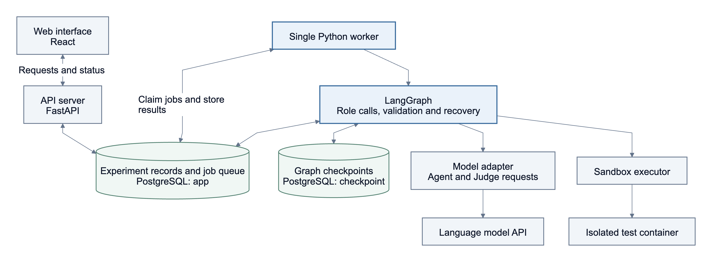
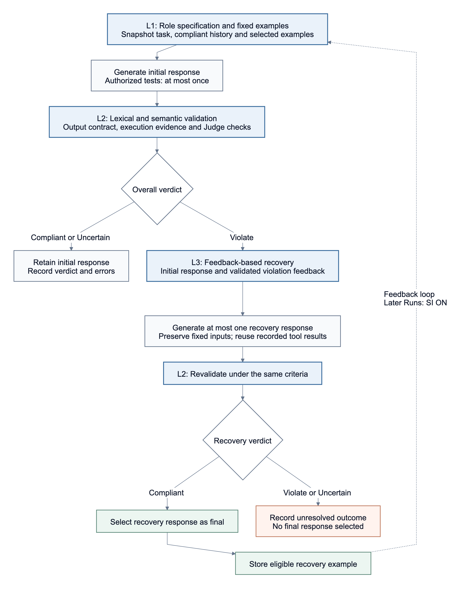
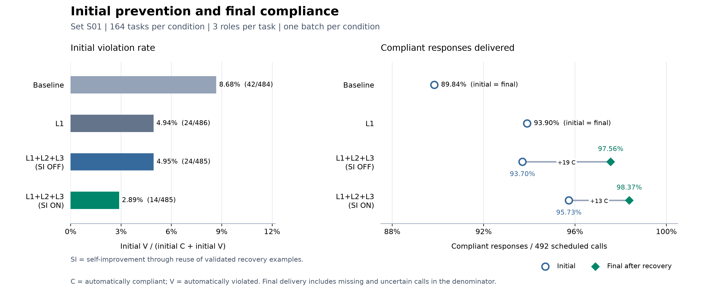
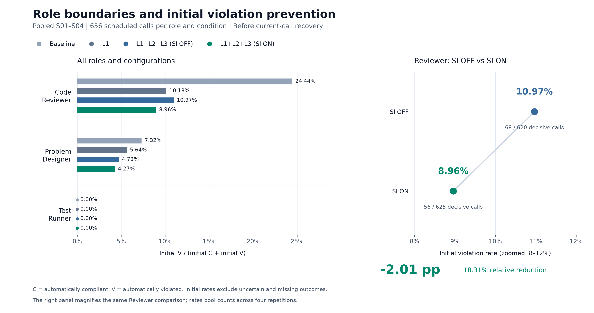
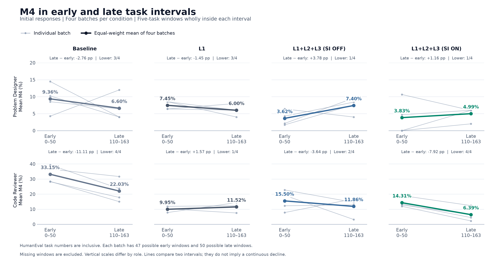
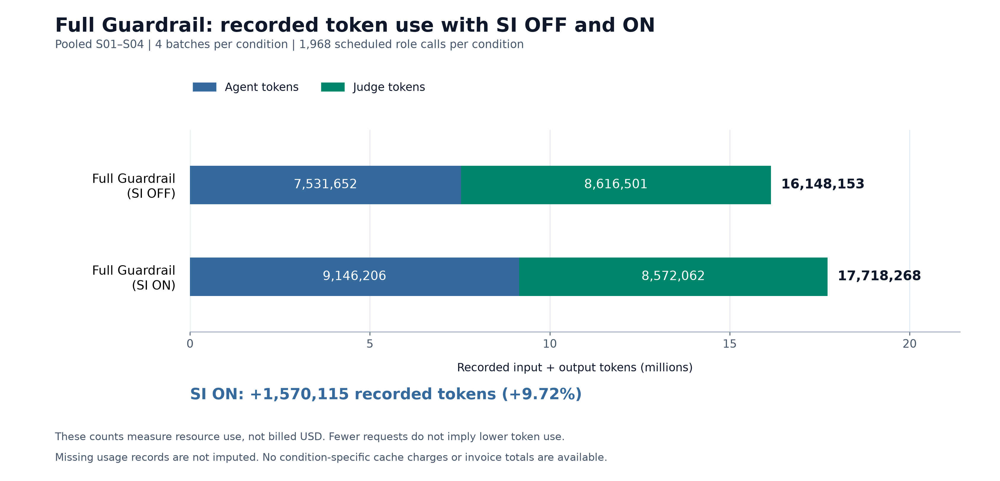

# Guardrail Lab

다중 에이전트 코딩 교육 시스템의 역할 일관성을 위한 3계층 가드레일 실행·평가 플랫폼.

## Abstract

Guardrail Lab은 Problem Designer, Code Reviewer, Test Runner의 역할 경계를 명세하고, 응답과 실행 증거를 검증하며, 확인된 위반을 피드백으로 복구하는 실험용 웹 플랫폼이다. L1은 상세 역할 명세와 고정 few-shot 예시, L2는 출력·실행 계약 검사와 LLM Judge 평가, L3는 피드백 기반 재생성과 재검증을 연결한다. SI(Self-improvement)는 검증된 복구 사례를 후속 과제의 동적 few-shot 예시로 재사용하는 기능이다. 과거 경험은 외부 저장소와 후속 입력을 통해 전달하며, 실행 중 모델 가중치와 역할 명세는 변경하지 않는다.

HumanEval 164개 과제의 참조 구현을 공통 후보 코드로 사용해 Baseline, L1, L1+L2+L3(SI OFF), L1+L2+L3(SI ON)을 비교하였다. 네 조건을 각각 한 배치씩 실행한 묶음을 한 실험 세트로 정의하고, S01의 1,968개 계획 역할 호출과 S01을 포함한 S01–S04의 16배치·7,872개 계획 역할 호출을 분석하였다. S01의 최종 자동 준수 응답 제공률은 네 조건에서 각각 89.84%, 93.90%, 97.56%, 98.37%였다. S01–S04 통합 결과에서 Code Reviewer의 초기 자동 위반율은 SI OFF 10.97%에서 SI ON 8.96%로 낮았으며, SI ON의 기록 토큰은 9.72% 많았다.

이 결과는 저장된 정책에 대한 자동 판정과 제한된 반복 실험의 관측이다. 경험 축적에 따른 지속적인 성능 향상, 사람 기준의 역할 침범 교정 또는 교육 효과를 입증하는 결과로 해석하지 않는다. 본 문서의 연구 설명과 그림은 `docs/final3/v5_ko.md`를 기준으로 정리하였다.

## 워크플로우

### 시스템 구성

React 화면과 FastAPI 서버가 실험 설정·접수·결과 조회를 담당하고, 독립 Python worker가 LangGraph로 역할 호출·평가·복구를 수행한다. PostgreSQL의 `app` 스키마에는 실험 기록과 작업 큐를, `checkpoint` 스키마에는 그래프 재개 상태를 저장한다. 테스트는 별도의 Docker sandbox에서 실행한다.



### 역할 실행과 검증·복구

실행 단위는 **Batch → Run → Round → Call**이다. 한 Run은 하나의 문제와 고정된 후보 코드를 다루며, 각 Round에서 **Problem Designer → Code Reviewer → Test Runner** 순서로 실행한다. 이 순서는 역할의 실행 순서이며, 각 역할은 서버의 원본 자료와 자신에게 허용된 입력을 사용한다.

| 역할 | 수행 업무 | 주요 경계 |
| --- | --- | --- |
| Problem Designer | 원본 요구사항과 함수 서명을 보존하는 문제 설명 | 정답·구현·풀이 힌트 공개 금지 |
| Code Reviewer | 후보 코드 오류의 위치·원인·영향을 정적으로 검토 | 수정 코드·단계별 수정 방법 제공 및 코드 실행 금지 |
| Test Runner | 고정된 후보 코드와 원본 테스트를 실행하고 결과 보고 | 코드·테스트 변경 및 실행 근거 없는 성공 주장 금지 |

1. **L1 — 입력 구성:** 역할 명세, 고정 예시, 현재 문제와 같은 배치·역할의 최신 준수 응답 최대 1개를 고정한다.
2. **응답 생성:** 허용된 도구를 사용하고 응답 원문과 실행 결과를 저장한다.
3. **L2 — 검증:** 금지 문자열, 출력 형식, 실행 증거와 Judge의 의미 판정을 결합해 준수(C)·위반(V)·불확실(U)을 기록한다.
4. **L3 — 복구:** FULL 모드에서 최초 응답의 확정 위반이 있으면 원본 응답과 위반 피드백으로 최대 1회 재생성하고 L2로 재검증한다. 복구가 준수이면 최종 응답으로 선택하고, 그렇지 않으면 미해결로 남긴다.
5. **SI — 경험 재사용:** SI ON에서는 같은 배치·역할의 적격 복구 사례를 후속 Run에 동적 예시로 전달한다. SI OFF에서도 준수 응답 이력과 현재 응답의 복구는 유지된다.



점선은 후속 Run으로의 복구 예시 전달을 나타낸다. 최초 판정이 U이면 복구 없이 응답을 유지하되 준수로 집계하지 않는다. Judge 판정 형식·인용 검증의 재시도는 L2 내부 절차이며, 에이전트 응답을 다시 생성하는 L3와 구분한다.

## 실험 그래프

아래 그래프는 HumanEval 164개 과제를 고정 순서로 실행한 결과이다. C는 자동 준수, V는 확정 위반, U는 불확실 판정이다. 초기 위반율의 분모는 최초 C+V이고, 준수 응답 제공률의 분모는 생성 실패·미해결·U를 포함한 전체 계획 호출 수이다.

### 최초 응답과 복구 후 최종 응답 — S01



조건별 계획 호출은 492회다. FULL의 SI OFF에서는 19건, SI ON에서는 13건이 복구 후 준수로 전환되었다. Baseline과 L1은 생성 명세·고정 예시뿐 아니라 Judge 정책 입력도 달라, 두 구성의 차이를 생성 지침만의 독립 효과로 해석하지 않는다.

### 역할별 초기 위반율 — S01–S04



Code Reviewer의 초기 자동 위반율은 SI OFF 68/620(10.97%)에서 SI ON 56/625(8.96%)로 2.01%p 낮았다. 네 반복 중 세 반복에서 감소가 관측되었으며, 이 비교는 현재 Call의 복구 이전 응답을 대상으로 한다.

### 초기·후반 구간의 이동 위반율(M4) — S01–S04



M4는 같은 배치·역할의 연속 5개 문제에서 최초 V/(C+V)로 계산한 이동 위반율이다. 초기 구간(HumanEval/0–50)과 후반 구간(HumanEval/110–163)을 비교하며, 굵은 선은 네 배치에 같은 가중치를 준 평균이다. 역할별 세로축 범위가 다르고, 두 구간의 차이는 전 구간의 지속적인 향상을 뜻하지 않는다. M4는 사후 분석 지표이며 복구 발동 조건은 현재 응답의 확정 위반이다.

### 토큰 사용량 — S01–S04



조건별 4배치·1,968개 계획 호출에서 기록된 총 토큰은 SI OFF 16,148,153개, SI ON 17,718,268개로 SI ON이 9.72% 많았다. 이는 Agent·Judge의 입력·출력 사용량이며, 캐시 요금이 반영된 실제 청구액은 아니다.

## 프로젝트 디렉토리

```text
.
├── assets/readme/          # README용 워크플로우·실험 그래프
├── backend/
│   ├── app/                # FastAPI, LangGraph, worker, 평가·복구·분석
│   ├── migrations/         # PostgreSQL 스키마 마이그레이션
│   ├── tests/              # 백엔드 검증
│   └── requirements.txt    # Python 의존성
├── frontend/
│   ├── src/                # React 실험·배치·결과 조회 화면
│   └── package.json        # 프런트엔드 의존성·빌드 설정
├── policies/               # 역할 명세와 Judge 평가 정책
├── sandbox/                # 격리 테스트 실행기와 Docker 이미지
├── data/                   # HumanEval 164문제, 출처·해시, 라이선스
├── docs/                   # 설계·실험 문서 및 로컬 연구 자료
├── scripts/                # 초기 설정, 데이터 가져오기·검증
├── .env.example            # 환경변수 예시
├── compose.yaml            # DB, API, worker, sandbox 서비스
├── Dockerfile              # 프런트엔드·백엔드 통합 빌드
├── Makefile                # 실행·종료·검증 명령
├── start.sh                # 기본 환경 시작
└── start-experiment.sh     # 독립 실험 환경 생성·재개
```

## 실행 방법

### 기본 실행

Docker Desktop 또는 Docker Engine과 Compose, 최초 설정용 Python 3가 필요하다. Docker를 실행한 뒤 저장소 루트에서 다음 명령을 실행한다.

```sh
./start.sh
```

스크립트는 `.env`가 없으면 인증 정보를 생성하고, 프런트엔드·백엔드·sandbox 이미지를 빌드한 뒤 PostgreSQL, migration·seed, API, worker, sandbox를 시작한다. 기존 `.env`와 DB 기록은 유지한다.

브라우저에서 **http://localhost:8000**에 접속하고 `.env`의 `APP_USERNAME`, `APP_PASSWORD`로 로그인한다. 포트를 변경했다면 실행 시 출력된 주소를 사용한다. React 화면은 FastAPI에서 함께 제공되므로 별도 프런트엔드 실행이 필요 없다.

기본 Agent·Judge는 `mock`이며 모델 API 키 없이 화면과 실행 흐름을 확인할 수 있다. 테스트의 실제 실행 여부는 `.env`의 `SANDBOX_MODE`를 따른다. 기본값 `docker`는 원본 테스트를 실행하고, `mock`은 미실행으로 기록한다.

### 실제 모델과 일괄 실험

`.env`의 `OPENAI_API_KEY`에 키를 설정하고 `OPENAI_MODELS`에 사용할 모델 ID를 쉼표로 구분해 지정한다. 설정을 반영한 뒤 화면에서 Agent와 Judge 모델을 선택한다.

```sh
docker compose up -d api worker
```

**일괄 실험**에서 정답 후보, 문제당 1 Round, Agent·Judge 모델을 선택한다. **역할별 사용자 요청 → 역할 명세 파일**에서 정책을 선택하고 다음과 같이 조건을 구성한다.

| 연구 조건 | 실행 모드 | 역할 명세 파일 | 복구 사례 few-shot | 평가 |
| --- | --- | --- | --- | --- |
| Baseline | `L1` | `base.yaml` | OFF | 자동 사후 평가 ON |
| L1 | `L1` | `default.yaml` | OFF | 자동 사후 평가 ON |
| L1+L2+L3 (SI OFF) | `FULL` | `default.yaml` | OFF | 온라인 검증·복구 |
| L1+L2+L3 (SI ON) | `FULL` | `default.yaml` | ON | 온라인 검증·복구 |

연구의 Baseline은 앱의 `Base` 모드가 아니라 **`L1` 모드 + `base.yaml`** 조합이다. SI ON/OFF는 **배치 내 복구 사례를 다음 Run의 few-shot으로 적용** 체크박스로 설정한다. 앱은 온라인 검증만 수행하는 `L1+L2` 모드도 지원하지만 위 네 조건 비교에는 포함하지 않았다.

**164문제 일괄 실행 시작**으로 실행하고, 배치 화면에서 진행 상태와 역할별 판정·복구 결과를 확인한다. **일괄 실행 기록 → 결과 다운로드**에서 CSV를 내려받을 수 있다. 그래프의 실험에서는 Agent·Judge 모두 `gpt-6-luna`, 문제당 1 Round, Run당 요청 상한 10회, Docker sandbox를 사용했다. 실제 모델을 선택하면 API 사용료가 발생한다.

### 독립된 실험 환경

조건별 DB와 실행 기록을 분리하려면 환경 이름과 포트를 지정한다.

```sh
./start-experiment.sh --name full-on --port 8011
./start-experiment.sh --name full-off --port 8012

# 종료했던 환경의 기존 기록으로 재개
./start-experiment.sh --name full-on --resume
```

환경 이름은 실험 조건을 자동으로 설정하지 않는다. 각 접속 주소에서 모드·정책·few-shot을 선택한다. 독립 환경의 로그 확인과 종료에는 스크립트가 출력한 해당 환경 전용 명령을 사용한다.

### 기본 환경 상태 확인·종료

```sh
# 서비스 상태
docker compose ps

# API·worker 로그
docker compose logs -f api worker

# 종료: DB 볼륨과 기록 유지
docker compose down
```
