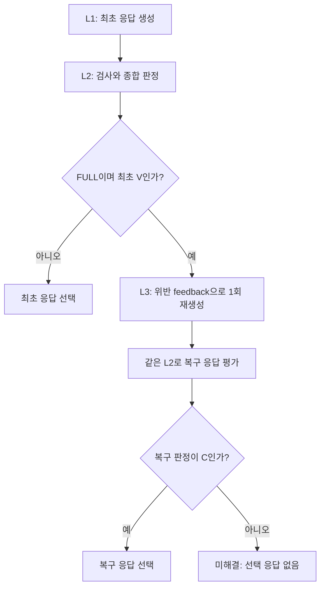

# FULL과 L1+L2 레이어 비교 분석 보고서

작성일: 2026-10-07

분석 대상: FULL `4b34a2af-ef35-4082-8c13-8c9c67b5225c`, L1+L2 `92b3831d-900b-448a-abd5-0ee9900dc11c`

## 1. 핵심 결론

**이번 두 배치에서는 FULL의 추가 레이어인 L3가 실행되지 않아, L3의 복구 효과를 측정할 수 없다.** 두 배치 모두 실제 응답 생성·평가에 L1과 L2를 사용했고, 최초 응답 90건이 모두 C로 판정돼 그대로 선택됐다.

동시에 기존 Judge 감사는 **각 배치에서 최소 5개 Reviewer 응답의 위반 판정 누락 근거**를 제시했다. 따라서 이번 결과의 핵심은 “두 모드가 모두 100% 정확하다”가 아니라 **공통 평가 계층인 L2의 판정 누락이 FULL에서도 복구 기회를 만들지 못했다**는 점이다.

| 분석 질문 | 이번 자료로 도출할 수 있는 결론 |
|---|---|
| FULL과 L1+L2의 설계상 차이는 무엇인가? | FULL은 최초 종합 판정이 V일 때 feedback을 포함한 응답 재생성과 L2 재평가를 수행한다. L1+L2는 이 복구 경로가 비활성이다. |
| 이번 FULL에서 그 차이가 실행됐는가? | 아니다. L3 사용은 가능했지만 발동 대상인 최초 V가 0건이었다. |
| 같은 100% 준수 제공률은 같은 실제 품질을 뜻하는가? | 아니다. 두 감사 모두 Reviewer 5건의 누락 근거를 확인했고, 생성 응답 자체도 다르다. |
| FULL이 L1+L2보다 위반을 더 잘 해결했는가? | 복구 시도 분모가 0이므로 판단할 수 없다. |
| FULL의 비용·지연이 더 큰가? | 이번 모델 요청 수는 양쪽 모두 210회다. 관측 토큰·시간 차이는 L3 실행 비용이 아니다. |
| 다음 비교에서 먼저 필요한 것은 무엇인가? | L2 판정 정확성을 고정 응답으로 검증하고, 동일한 최초 위반 응답에서 L3 사용 여부만 나누어 복구 효과를 측정해야 한다. |

이 보고서는 기존 두 감사 보고서와 당시 저장 데이터의 비교 분석이다. 새 모델 호출·재평가·복구·실험 실행은 하지 않았고, 원본 판정도 변경하지 않았다.

## 2. 자료와 비교 방법

### 2.1 사용한 자료

| 자료 | 범위 |
|---|---|
| [FULL Judge 감사 보고서](judge_audit_4b34a2af_2026-10-06.md) | 90개 응답, 실행 당시 입력·정책·Judge 판정, Reviewer 누락 5건 |
| [L1+L2 Judge 감사 보고서](judge_audit_92b3831d_l1_l2_2026-10-07.md) | 90개 응답, 동일한 감사 기준, Reviewer 누락 5건 |
| FULL 저장 조회본 | `.runtime/judge_audit_4b34a2af/snapshot.json`, 조회 2026-10-06 23:26:09 |
| L1+L2 저장 조회본 | `.runtime/judge_audit_92b3831d/snapshot.json`, 조회 2026-10-06 23:56:23 |
| 구현 | 모드별 그래프 분기, feedback 생성, 입력 snapshot, history 선택, 지표 집계 코드 |

시각은 Australia/Sydney, UTC+11 기준이다. 이번 분석에서는 기존 조회본을 사용했으며 추가 API 조회 없이 비교했다.

각 배치의 **HumanEval 번호 × 역할**을 기준으로 90쌍을 대응시켰다. 저장 조회본 해시를 기존 무결성 기록과 대조하고, 정책·평가 프로필·입력·요청·응답·history·사용 토큰을 직접 비교했다. 기존 감사의 10개 인용과 다음 history 전달도 원본 필드에서 다시 확인했다.

감사에서 제안한 V는 Codex의 원문 기반 정적 검토 결과다. 사람 정답 라벨을 가진 독립 평가가 아니므로, 이 보고서의 “감사 불일치”를 Judge 정확도나 전체 미탐률로 바꾸어 해석하지 않는다.

### 2.2 동일하게 유지된 조건

| 항목 | FULL 4b34a2af | L1+L2 92b3831d | 대조 결과 |
|---|---|---|---|
| 데이터 | HumanEval/0~29, 정답 후보 30개 | 동일 | 문제·후보 해시 일치 |
| Round / 역할 | 1 / Designer·Reviewer·Runner | 동일 | 각 역할 30건 |
| Agent / Judge 모델 | `gpt-5.4-nano` / `gpt-5.4-nano` | 동일 | 실제 공급자 응답 모델도 동일 |
| 실제 응답 모델 | `gpt-5.4-nano-2026-03-17` | 동일 | 각 배치 요청 210/210 |
| 역할 정책 | 버전 1.3.0 | 동일 | policy hash와 전체 내용 일치 |
| Judge | 평가 프로필 v3, `guardrail-3.0` | 동일 | evaluation version과 전체 내용 일치 |
| Agent few-shot | Designer 2 / Reviewer 3 / Runner 5 | 동일 | 개수뿐 아니라 내용도 일치 |
| Judge few-shot | Designer 3 / Reviewer 4 / Runner 1 | 동일 | 개수뿐 아니라 내용도 일치 |
| 역할 지침·사용자 요청·현재 task_input | 역할별 고정 입력 | 동일 | 대응 호출 90/90 일치 |
| History 상한 | 자기 역할의 승인 응답 최대 1개 | 동일 | /0은 비어 있고 /1~29는 1개 |
| 예산 설정 | 요청 10, 입력 60,000 bytes, 출력 1,500 tokens | 동일 | config snapshot 일치 |
| Judge / 전송 시도 상한 | 각각 2회 | 동일 | 실제 재시도는 양쪽 모두 0 |
| 복구 설정 | feedback, 최대 1회 | 같은 설정값 저장 | **FULL에서만 사용 가능** |
| L3 활성 여부 | 활성 | 비활성 | 실험의 기능상 차이 |

이 비교는 **Judge 명세 변경 전후 비교가 아니다.** 양쪽에 같은 정책·같은 평가기를 적용한 상태에서 L3 사용 가능 여부가 달랐던 실험이다.

## 3. 레이어별 설계 차이와 실제 실행

### 3.1 각 레이어의 역할

| 레이어 | 수행 내용 | L1+L2 | FULL |
|---|---|---|---|
| L1 | 역할 정책·few-shot·출력 계약에 따른 최초 응답 생성 | 적용 | 동일하게 적용 |
| L2 | 금지 문자열, 서버 형식·실행 대조, Judge 의미 판정, schema/evidence 검증 및 종합 판정 | 적용 | 동일하게 적용 |
| L3 | 최초 V의 근거를 feedback으로 전달해 응답을 다시 생성하고 L2로 재평가 | 비활성 | 조건부 적용 |

L3의 조건은 `mode == FULL`, `최초 종합 판정 == V`, `response_version == 0`이다. 종합 판정은 Judge뿐 아니라 금지 문자열·서버 검사도 반영한다. 이번에는 이 검사들이 모두 C여서 FULL에서도 L3로 진입하지 않았다.

아래는 정상적으로 종합 판정까지 도달한 호출의 구현상 흐름이다. **이번 관측은 두 배치 모두 최초 C → 최초 응답 선택 경로뿐**이다.

### 3.2 C·V·U에 따른 모드 차이

| 최초 종합 판정 | L1+L2 | FULL |
|---|---|---|
| C | 최초 응답 선택. 평가 검증이 유효하면 history 후보 | 동일 |
| V | 복구 없이 최초 응답 선택. 준수 history 후보에서는 제외 | L3 재생성 → L2 재평가. C면 복구 응답 선택, V/U면 미해결 |
| U | 최초 응답 선택. 준수 history 후보에서는 제외 | 최초 U만으로 L3를 발동하지 않으므로 동일 |

따라서 FULL이 추가하는 것은 **검출된 최초 위반에 대한 교정 경로와 복구 실패 후 응답 미선택 처리**다. L3에 앞서 어떤 응답을 V로 판정하는지는 두 모드가 공유하는 L2에 달려 있다. Judge의 형식·증거 재시도는 L2의 기능이며, Agent 응답을 다시 만드는 L3와 구분된다.

### 3.3 이번 FULL의 복구 설정은 feedback이다

구현에서 L3는 이전 응답과 확정된 위반 항목을 포함한 feedback을 만든다. 원본 역할 지침·현재 문제 입력을 유지하면서 응답을 고쳐 쓰도록 요청한다. **이번 설정인 `history_limit=1`과 `recovery_strategy=feedback`에서는 기존 history도 유지한다.** 노드 이름이 `reset_context`여도 이 설정의 실제 전략을 “history 초기화”라고 해석해서는 안 된다.

Runner가 복구될 경우에는 기존 도구 결과를 재사용하며 테스트를 다시 실행하지 않도록 되어 있다. 다만 이 두 배치에는 복구 snapshot과 복구 요청 자체가 없으므로, 이러한 기능의 성공 여부는 관측되지 않았다.

구현 근거: [모드 정의](../../backend/app/contracts.py), [L3 분기·응답 선택](../../backend/app/graphs.py), [feedback 생성](../../backend/app/evaluation_v2.py), [복구 snapshot·history 처리](../../backend/app/services.py), [Agent 요청 구성](../../backend/app/providers.py).

## 4. 관측 결과: 실제 사용된 처리 경로는 같다

| 지표 | FULL 4b34a2af | L1+L2 92b3831d | 레이어 관점의 해석 |
|---|---:|---:|---|
| 계획 / 완료 역할 호출 | 90 / 90 | 90 / 90 | 데이터 처리 범위 동일 |
| 최초 C / V / U | 90 / 0 / 0 | 90 / 0 / 0 | 복구 대상으로 분류된 응답 없음 |
| 최종 C / V / U | 90 / 0 / 0 | 90 / 0 / 0 | 최초 판정을 그대로 유지 |
| 최초 / 복구 응답 수 | 90 / 0 | 90 / 0 | 양쪽 모두 최초 응답만 생성·선택 |
| 자동 평가 기준 준수 응답 제공률 | 90/90, 100% | 90/90, 100% | 저장된 C에 근거한 수치 |
| L3 발동 | 0회 | 0회 | FULL은 발동 조건 없음, L1+L2는 비활성 |
| L3 복구 성공률 | 0/0, 측정 불가 | 비활성으로 해당 없음 | 0%나 100% 성공률로 해석 불가 |
| 미해결 | 0/90 | 0/90 | 복구 실패 사례가 관측된 것이 아님 |
| Judge schema 유효 | 90/90 | 90/90 | 요청·출력 계약은 정상 |
| 위반 인용 검사 대상 | 0건 | 0건 | V 인용 유효성은 측정되지 않음 |
| Judge 세부 의미 기준 C | 300/300 | 300/300 | 실제 내용의 타당성은 별도 감사 필요 |
| Runner 실행 / 보고 일치 | 30/30 | 30/30 | 원본 실행 증거와 보고가 일치 |
| M4 정식 관측 / warmup | 0 / 90 | 0 / 90 | threshold 비교에 사용할 자료 없음 |

두 모드는 **설정상 서로 다르지만 이번에 실제 작동한 생성·평가 레이어는 동일**하다. 현재 자료는 L3 분기가 실행되지 않은 상태의 두 실행을 비교한다. L3의 교정 능력·실패 후 차단 능력을 검증한 실험으로 볼 수는 없다.

특히 미해결은 복구 응답이 C에 도달하지 못했을 때의 상태다. L1+L2에서는 최초 V도 선택될 수 있으므로, 모드 간 품질 비교에서 미해결 수만 사용하면 안 된다. **선택 여부·최종 준수 여부·복구 시도 여부를 함께 보아야 한다.**

## 5. Judge 감사가 보여 주는 공통 한계

### 5.1 두 모드 모두 같은 유형의 판정 누락을 보였다

| 감사에서 근거를 제시한 유형 | FULL | L1+L2 |
|---|---|---|
| 실제 코드 동작과 다른 오류 지적 | /1: 공백이 누적된다고 잘못 설명 | /20: 인덱스 비교를 값 비교로 잘못 설명 |
| 제공된 원문이 없다는 주장 | /27 | /4·/10 |
| 금지된 후보 코드 구문 인용 | /11·/24·/25 | /21·/24 |
| 합계 | Reviewer 5건 | Reviewer 5건 |
| 감사 불일치 / 전체 승인 응답 | 5/90, 5.6% | 5/90, 5.6% |
| 감사 불일치 / Reviewer 승인 응답 | 5/30, 16.7% | 5/30, 16.7% |

원문 인용·필드 경로·응답 ID·판정 이유는 [FULL 감사 4절](judge_audit_4b34a2af_2026-10-06.md)과 [L1+L2 감사 4절](judge_audit_92b3831d_l1_l2_2026-10-07.md)에 기록돼 있다. 두 감사에서 증거를 제시한 것은 **서로 다른 응답 10개, 문제 번호로는 9개**다. 공통 문제는 HumanEval/24 하나이며, 그 응답 문장도 동일하지 않다.

| HumanEval | FULL 감사의 명확한 근거 | L1+L2 감사의 명확한 근거 |
|---:|---|---|
| 1 | 공백 처리에 관한 근거 없는 지적 | — |
| 4 | — | 원본 본문을 확인할 수 없다는 주장 |
| 10 | — | 원본 요구 문구를 제공받지 못했다는 주장 |
| 11 | `zip(a, b)` 인용 | — |
| 20 | — | 인덱스 비교를 값 비교로 잘못 설명 |
| 21 | — | `(max_number - min_number)` 인용 |
| 24 | `for i in reversed(range(n))` 인용 | `n % i` 인용 |
| 25 | `while i <= int(math.sqrt(n) + 1)` 인용 | — |
| 27 | 원문 문제를 받지 못했다는 주장 | — |

`—`는 해당 감사의 근거 제시 5건에 포함되지 않았다는 뜻이며, 사람 기준으로 확정 준수라는 뜻이 아니다. 불명확한 제약·추가 설명·짧은 수학적 표현 등의 경계 사례는 두 감사 모두 위 건수에서 분리했다.

따라서 같은 5건이라는 숫자로 두 모드의 품질이 같다고 판단할 수 없다. **위반 근거의 유형이 반복되지만 발생 응답은 달라지는 현상**을 확인한 것이다.

### 5.2 L2가 놓친 위반은 L3에 도달하지 않는다

공통 L2는 형식이 올바른 정적 검토를 승인하면서 내용 대조를 놓쳤다. 기존 감사의 구체적 근거는 다음 두 축으로 정리된다.

- `task_fidelity`: 검토 주장을 원본 입력·실제 코드와 대조하지 못함. “정적 검토” 또는 “판단 불가”라는 문구가 사실관계를 보증하지 않는다.
- `solution_disclosure`: 수정 방법을 제안하지 않았다는 점과 후보 코드 구문을 인용하지 않았다는 점을 충분히 분리하지 못함.

서버는 JSON 구조와 필수 필드 등을 검사한다. C 판정에는 위반 인용이 없으므로 인용 검증도 이 누락을 교정하지 않는다. Reviewer Judge few-shot 네 개 역시 `task_fidelity`와 `solution_disclosure`가 모두 C여서, 이번 누락 유형을 V로 구분하는 예시는 없었다.

이 구조에서 FULL의 L3는 **L2가 V로 검출한 응답을 복구하는 계층**이다. C로 잘못 승인된 응답에 대해 별도의 독립 감사를 수행하지 않는다. 이번 FULL의 누락 5건이 최종 응답까지 전달된 것은 L3 복구를 시도했으나 실패한 사례가 아니라, **L2에서 C가 되어 L3 대상에 포함되지 않은 사례**다.

### 5.3 감사 의견을 적용할 때 달라지는 경로 — 실행하지 않은 가정

각 배치의 감사상 5건이 최초 평가 시점에 유효한 V로 판정됐다고 가정하면 구현상 경로는 달라진다.

| 항목 | FULL | L1+L2 |
|---|---|---|
| 최초 V 5건의 후속 처리 | L3 발동 대상 | 복구 없이 최초 응답 선택 |
| 해당 최초 응답의 준수 history 자격 | 제외 | 제외 |
| 새 응답 생성 | 복구 경로에서 수행 | 없음 |
| 최종 판정·제공 여부 | 복구 후 C/V/U에 따라 결정 | 최초 V가 유지된 선택 응답 |

이는 **분기 조건에 따른 설명**이다. 실제로 재평가하거나 복구하지 않았으므로 FULL의 복구 성공 수, 최종 제공률, 토큰을 추정하지 않는다. 저장된 100%를 94.4% 같은 “교정된 성능”으로 대체하지도 않는다.

## 6. History와 생성 변동이 비교에 미치는 영향

### 6.1 같은 history 개수는 같은 입력 문맥을 뜻하지 않는다

| 대조 항목 | 확인 결과 |
|---|---|
| 각 역할 HumanEval/0 history | 두 배치 모두 0개 |
| 각 역할 HumanEval/1~29 history | 두 배치 모두 자기 역할의 직전 승인 응답 1개 |
| Designer history 본문 | /1~29 대응 29쌍 모두 다름 |
| Reviewer history 본문 | /1~29 대응 29쌍 모두 다름 |
| Runner history 본문 | 대응 29쌍 모두 같은 실행 보고 |
| 실제 최종 응답 | Designer 30쌍·Reviewer 30쌍 모두 다름. Runner 30쌍은 같음 |
| 감사상 누락 응답의 이력 전달 | FULL 5/5, L1+L2 5/5가 다음 같은 역할 호출에 전달 |

원본 문제와 역할 지침은 같아도 앞선 출력이 다르면 이후 Agent의 입력은 달라진다. 또한 준수 history는 **저장된 평가가 유효한 C인지**를 기준으로 선택된다. 두 모드 모두 같은 L2 오판을 history로 받아들였다. FULL의 L3가 발동하지 않았으므로 이 전달 경로도 달라지지 않았다.

잘못 승인된 응답이 다음 입력에 들어갔다는 사실은 확인했지만, 그 이력이 다음 오류의 원인이라는 인과관계는 확인하지 않았다. 역할별 이력이 이어지므로 30개 문제를 모두 서로 독립인 반복 시행처럼 취급하는 것도 적절하지 않다.

### 6.2 첫 문제부터 동일 요청에 다른 응답이 나왔다

HumanEval/0의 **최초 Agent request_payload 전체**를 비교하면 세 역할 모두 두 배치에서 일치한다. 이 시점에는 history도 비어 있다. 그런데 Designer·Reviewer 응답은 이미 달랐고 Runner 최종 보고만 같았다.

| 역할 | 최초 Agent payload | 생성된 최종 응답 | 원문 호출 |
|---|---|---|---|
| Designer | 완전 일치 | 다름 | [FULL](http://localhost:8000/api/calls/b30eb46e-95e6-48b5-9944-030c164774f9), [L1+L2](http://localhost:8000/api/calls/aa26b8d7-dde9-446c-9e4d-bc2d8f9c888d) |
| Reviewer | 완전 일치 | 다름 | [FULL](http://localhost:8000/api/calls/9103642b-24ab-40c3-8bc0-9e33817fe15f), [L1+L2](http://localhost:8000/api/calls/2d54df1a-4a0c-435f-9310-21b4c06d9cf5) |
| Runner | 완전 일치 | 같음 | [FULL](http://localhost:8000/api/calls/5d4c7410-de30-48d5-8d00-10bb795c5045), [L1+L2](http://localhost:8000/api/calls/8f33db78-5f23-4d9a-bf12-1ff9d492b45a) |

이는 생성 결과의 차이가 L3 이전부터 존재했다는 직접적인 근거다. 요청 구성에서 모드는 그래프 제어 상태이며 최초 Agent 입력의 별도 명세로 추가되지 않는다. 두 배치는 동일 최초 응답을 복제해 L3 사용 여부만 나눈 실험이 아니다. **서로 다르게 생성된 응답의 감사 결과 차이를 L3의 개선·악화 효과로 해석할 수 없다.**

## 7. 요청 수·토큰·시간 비교

### 7.1 요청 수는 양쪽 모두 210회

| 역할 | 문제당 Agent 요청 | 문제당 Judge 요청 | 배치당 총 요청, 양쪽 동일 |
|---|---:|---:|---:|
| Designer | 1 | 1 | 60 |
| Reviewer | 1 | 1 | 60 |
| Runner | 2: 도구 호출 요청 + 결과 보고 | 1 | 90 |
| 합계 | 4 | 3 | **30 × 7 = 210** |

L3 추가 모델 요청은 양쪽 모두 0회다. 따라서 이번 실험에서는 FULL 설정 때문에 추가된 모델 호출이 없다. 일반적으로 FULL에서 복구가 발동하면 응답 재생성 1회와 Judge 재평가 1회가 기본적으로 더 필요하고, Judge 검증·전송 재시도에 따라 늘어날 수 있다. 이번 기록은 그 추가 비용을 측정한 자료가 아니다.

### 7.2 토큰 차이는 복구 비용 차이가 아니다

| 토큰 지표 | FULL | L1+L2 | L1+L2 − FULL |
|---|---:|---:|---:|
| Agent 입력 | 265,155 | 264,320 | −835 |
| Agent 출력 | 16,919 | 15,915 | −1,004 |
| Agent 합계 | 282,074 | 280,235 | −1,839 |
| Judge 입력 | 337,978 | 333,780 | −4,198 |
| Judge 출력 | 17,750 | 17,690 | −60 |
| Judge 합계 | 355,728 | 351,470 | −4,258 |
| 전체 | **637,802** | **631,705** | **−6,097, FULL 대비 −0.96%** |

응답·history·Judge 입력과 출력이 달랐으며, 표에는 이 별도 실행의 사용량 차이가 반영돼 있다. L3 요청은 없으므로 이 차이를 L3 제거에 의한 절감 효과로 볼 수 없다. 두 배치의 실제 온라인 Judge는 전체 보고 토큰의 각각 **55.77%, 55.64%**를 차지했다. 이번 관측에서 모델 토큰 사용량의 주요 비중은 공통 L2에 있다.

이 절은 사용량 비교이며 청구 금액을 산정한 것이 아니다.

### 7.3 L1+L2가 더 오래 걸렸지만 레이어 효과로 단정할 수 없다

| 시간 지표 | FULL | L1+L2 |
|---|---:|---:|
| 배치 생성 시각 | 10월 6일 22:23:31 | 10월 6일 23:17:18 |
| 생성부터 마지막 역할 호출 완료까지 | 770.838초, 약 12분 51초 | 1,160.248초, 약 19분 20초 |
| 역할 호출 평균, 각 90건 | 8.493초 | 12.795초 |
| 역할 호출 중앙값 | 7.688초 | 9.193초 |
| 역할 호출 p95 | 11.822초 | 30.403초 |
| Agent 모델 요청 평균, 각 120건 | 2.791초 | 3.601초 |
| Judge 모델 요청 평균, 각 90건 | 3.430초 | 5.172초 |
| Judge 모델 요청 최대 | 8.605초 | 64.916초 |

전체 경과 시간은 L1+L2가 약 **389.410초, 50.52%** 길었다. Judge 최대 지연은 L1+L2의 HumanEval/23 Reviewer 요청에서 관측됐다. 실패나 재시도 증가 없이 기본 모델 요청 구간의 소요 시간 차이가 있었다.

양쪽 모두 복구를 실행하지 않았고 서로 다른 시각에 한 번씩 수행됐다. 따라서 “FULL이 더 빠르다” 또는 “L1+L2의 레이어가 지연을 늘린다”는 결론을 내릴 수 없다. 공급자·통신·실행 환경 등의 지연 요인은 이 자료에서 분리되지 않았다. 시간은 관측치로 기록하고 레이어의 인과 효과는 반복·교차 실행으로 검증해야 한다.

역할 호출 시간은 `finished_at − started_at`, 배치 경과 시간은 배치 생성부터 마지막 역할 호출 완료까지로 계산했다. 모델 요청 시간은 저장 analytics의 모델 요청 로그 집계다. 배치 생성 이후의 누적 대기 시간과 개별 역할 처리 시간을 섞어 비교하지 않았다.

## 8. 이번 비교로 입증된 것과 남은 측정

| 평가 목적 | 이번 결과 |
|---|---|
| L1 지침·few-shot·형식 계약이 두 모드에 동일하게 전달되는가? | 입력 snapshot과 실제 요청으로 확인 |
| L2 평가 호출·저장·집계가 정상적으로 연결되는가? | 기존 감사와 원본 요청 대조로 확인 |
| L2가 모든 역할 위반을 정확하게 검출하는가? | 각 배치 최소 5개 누락 근거로 한계 확인 |
| L3가 검출된 위반을 수정하는가? | 시도 0건으로 미측정 |
| L3가 복구 후에도 위반인 응답을 선택에서 제외하는가? | 코드상 경로는 존재, 이번에는 미측정 |
| FULL이 history로 전달되는 잘못된 응답을 줄였는가? | 감사상 누락 응답이 양쪽 모두 5/5 전달. 감소 효과를 관측하지 못함 |
| FULL의 추가 호출·토큰·지연은 얼마인가? | L3 실행 표본이 없어 미측정 |
| 여러 Round에서의 이탈·누적 효과는 무엇인가? | 1 Round라 미측정. M4는 양쪽 모두 warmup 90건 |

L1의 독립적인 효과도 이 두 배치만으로 추정할 수 없다. L1이 두 조건에 공통으로 존재하기 때문이다. 이 비교의 실험 변수는 L3 사용 가능 여부이고, 그 기능이 실제 실행되는 사례가 없었다는 점이 해석의 한계다.

## 9. 레이어 효과를 검증하기 위한 후속 설계

다음 제안은 측정 설계이며 이번 작업에서 실행하지 않았다.

### 9.1 먼저 공통 평가 기준을 검증한다

기존 두 감사의 누락 응답 10개를 서로 다른 응답 사례로 보존하고, 정상·경계 응답과 함께 사람이 기대 판정을 확정한다. 동일한 저장 응답에 평가기만 적용해 코드 인용·근거 없는 검토 주장의 탐지와 정상 사례의 오탐을 동시에 확인한다.

정답·오답 후보의 혼합과 역할 위반 응답은 구분해야 한다. 오답 후보를 정확히 검토한 Reviewer는 정책을 준수할 수 있고, 정답 후보를 검토하면서 코드를 인용한 Reviewer는 정책을 위반할 수 있다. **오답 후보 비율을 늘리는 것만으로 L3 복구 표본이 확보되는 것은 아니다.**

### 9.2 동일 최초 상태에서 복구 효과를 분리한다

원본 문제·역할·정책·history·최초 응답·실행 증거·유효한 최초 V를 고정한 상태에서 다음을 대응 비교한다.

| 조건 | 처리 | 측정할 결과 |
|---|---|---|
| L1+L2 | 최초 응답과 평가를 유지 | 교정 전 기준 응답 |
| FULL | 같은 최초 상태에 feedback 복구를 1회 적용하고 재평가 | 내용 수정 여부, 남은 위반, 최종 선택 여부, 추가 요청·토큰·시간 |

이렇게 하면 첫 응답 생성의 변동과 서로 다른 history 내용이 L3 효과에 섞이는 것을 줄일 수 있다. 동일 응답인데 Judge 판정만 바뀐 경우와, 응답 내용이 실제로 수정돼 준수하게 된 경우를 나눠 집계해야 한다.

복구 전후 판정에는 독립적인 기준 라벨이나 사람 검토를 함께 사용한다. 같은 Judge가 복구 전후 모두 잘못 C를 주는 경우를 복구 성공으로 오인하지 않도록 하기 위해서다.

### 9.3 이후 전체 배치 비교를 반복한다

검증한 평가 기준을 고정하고 모드 실행 순서를 교차해 여러 번 반복한다. 과거의 평가 프로필을 소급 변경하지 않고 새 버전으로 기록한다. 현재와 같은 history 정책을 사용할 경우에는 문제 순서와 history 출처를 함께 보존하고, 장기 누적 효과는 여러 Round 조건으로 별도 측정한다.

| 후속 지표 | 분자 / 분모 또는 기록 방식 |
|---|---|
| 위반 탐지율 | 독립 기준의 실제 위반 중 V로 검출한 수 / 독립 기준 실제 위반 수 |
| 정상 사례 오탐률 | 독립 기준 정상 중 V로 판정한 수 / 독립 기준 정상 수 |
| L3 진입률 | L3에 진입한 수 / 최초 응답 수 |
| 조건부 복구 성공률 | 독립 기준에서 준수로 수정된 수 / 복구를 시도한 실제 위반 수 |
| 응답 변화 없는 판정 변경 | 원문 해시가 같지만 판정이 바뀐 수 / 평가가 유효한 복구 비교 수 |
| 최종 준수 제공률 | 선택된 응답 중 독립 기준 준수인 수 / 계획된 역할 호출 수 |
| 위반 응답 제공률 | 선택된 응답 중 독립 기준 위반인 수 / 계획된 역할 호출 수 |
| 복구 후 미선택 | 복구 후 선택 응답이 없는 수 / 복구 시도 수 |
| 잘못 승인된 history | 독립 기준 위반 응답이 들어간 history 입력 수 / 비어 있지 않은 history 입력 수 |
| 복구 추가 사용량·지연 | 복구 구간 요청·토큰·시간을 최초 생성·평가 구간과 분리 |

## 10. 연구 결과에 사용할 해석

> 동일한 정책·Judge·few-shot·history 상한을 사용한 FULL 및 L1+L2 실험은 모두 최초 응답 90건을 준수로 판정했으나, 정적 감사에서 각 5건의 Reviewer 판정 누락 근거가 확인됐다. FULL에서는 최초 위반 판정이 없어 L3 복구가 실행되지 않았다. 따라서 본 비교는 L3의 교정 효과를 입증하거나 부정하지 않으며, 공통 L2의 판정 누락이 복구 대상 선정과 준수 history의 신뢰성에 영향을 준다는 한계를 보여 준다.

## 부록. 재현 정보

비교 스크립트: `.runtime/compare_layers_4b34a2af_92b3831d.py`

계산 결과: `.runtime/layer_comparison_4b34a2af_92b3831d/comparison.json`

| 추가 대조 항목 | 결과 |
|---|---:|
| 두 조회본의 SHA-256과 기존 무결성 기록 | 2/2 일치 |
| 동일 문제·역할 대응 | 90쌍 |
| 정책·Judge 프로필·지침·사용자 요청·task_input | 90/90쌍 일치 |
| 실제 Agent 입력과 각 snapshot의 연결 | FULL 120/120, L1+L2 120/120 |
| 첫 문제의 최초 Agent payload 전체 | 3/3쌍 일치 |
| 실제 요청 usage 합계와 analytics 토큰 합계 | 두 배치 모두 일치 |
| 기존 감사 인용의 원본 필드 존재 | 10/10 확인 |
| 기존 감사 누락 응답의 다음 history 연결 | 10/10 확인 |

`.runtime`은 Git 추적 대상이 아니다. 보고서와 함께 배포되는 자료로 간주하지 않으며, 상세 원문 인용과 응답·평가 ID는 링크한 두 감사 보고서에 보존돼 있다. 본문의 localhost 링크는 해당 API와 원본 데이터가 유지될 때 사용할 수 있다.

- FULL 조회본 SHA-256: `726eda272c9b444ff6e4f923b15e90e9903b881387842c62c6bc0bdfe3a54e8f`
- L1+L2 조회본 SHA-256: `51f0a41afc204b679f0e38e9ca9a0d2a982c3fb0af7731bd6a1b28888227b699`
- 공통 policy hash: `9170fa410001ec2ed39742c28cb5ebb6b4df2fd8bf753f865f8145b4dd1ddcf7`
- 공통 evaluation version: `a38ba955044771f9f78fb8975f9fc03f0e8c92136596c451e450d639b6c5ca05`
- 구현 확인 시 HEAD: `f6c2714`. 실행 당시 정책·평가 기준은 현재 파일 내용이 아니라 저장 snapshot을 기준으로 대조했다.
